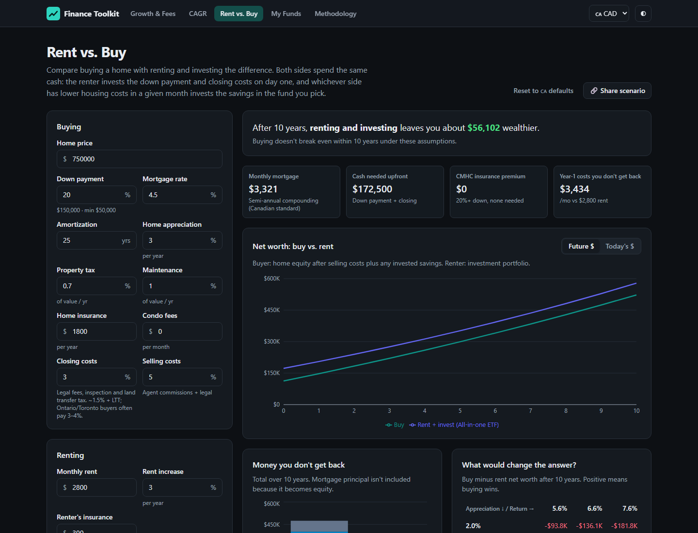

# Finance Toolkit

**Live site: [mahabdulkhaliq.github.io/finance-toolkit](https://mahabdulkhaliq.github.io/finance-toolkit/)**


Four connected personal-finance calculators, built as a static site for GitHub Pages:

- **Growth & Fees**: compare any number of funds by MER / expense ratio, with contributions, frequency, timing and yearly raises. Shows the full cost of fees, including the growth those fees would have earned.
- **CAGR**: solve for growth rate, end value, start value or time, and compare several investments. Any result can be saved as a fund.
- **Rent vs. Buy**: a monthly simulation of buying vs. renting and investing the difference in a fund from your library. Includes break-even year, cost breakdown and sensitivity grid.
- **Retirement**: years until your portfolio covers your spending (savings rate, withdrawal rate, today's dollars), comparing funds from your library to show how fees move your retirement date.

A shared **fund library** (stored in localStorage) connects the tools. A **🇨🇦 Canada / 🇺🇸 US toggle** switches currency, terminology and mortgage rules (semi-annual compounding + CMHC vs. monthly compounding + PMI). Every scenario can be shared as a link, and results can be shown in today's dollars. Dark mode is supported.



## Stack

React 18 · TypeScript · Vite · Tailwind CSS v4 · Recharts · Zustand · React Router (HashRouter) · lz-string · Vitest

## Development

```bash
npm install
npm run dev      # http://localhost:5173
npm test         # finance unit tests
npm run build    # type-check + production build to dist/
```

The finance logic lives in [`src/lib/finance`](src/lib/finance) as pure functions with unit tests. See the in-app **Methodology** page for formulas and assumptions.

## Deploying to GitHub Pages

1. Push this repo to GitHub with `main` as the default branch.
2. In **Settings → Pages**, set **Source** to **GitHub Actions**.
3. Each push to `main` runs [`.github/workflows/deploy.yml`](.github/workflows/deploy.yml), which runs the tests, builds the site and publishes it.

Vite uses a relative `base`, and routes are hash-based (`/#/growth`), so the site works under any repo name with no extra configuration.

## Disclaimer

Educational estimates only, not financial advice.
